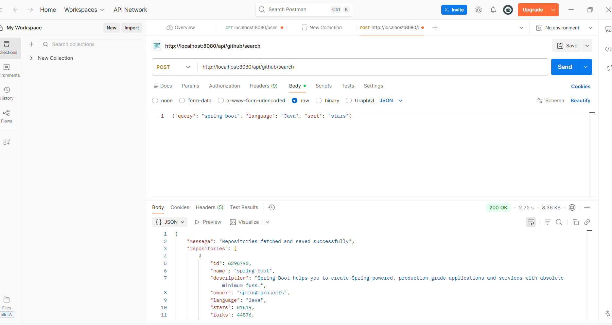
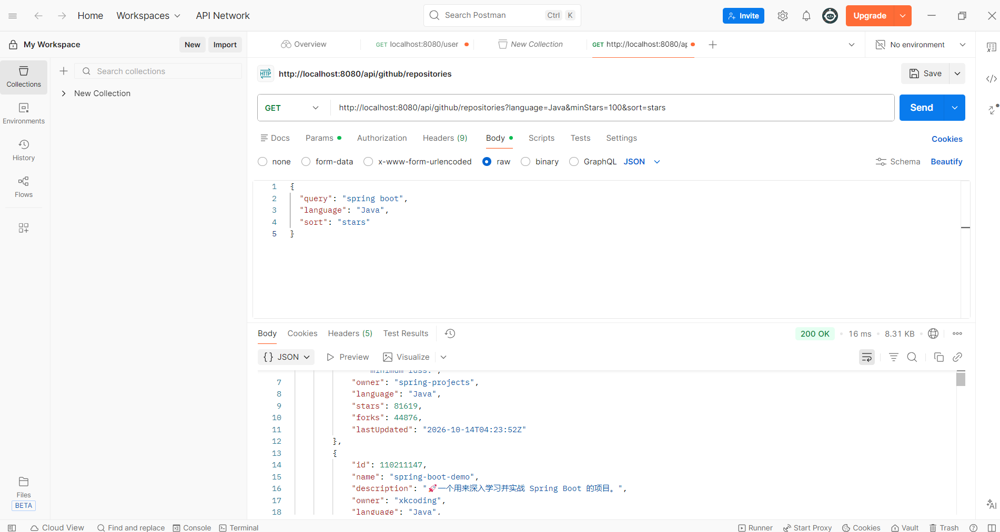
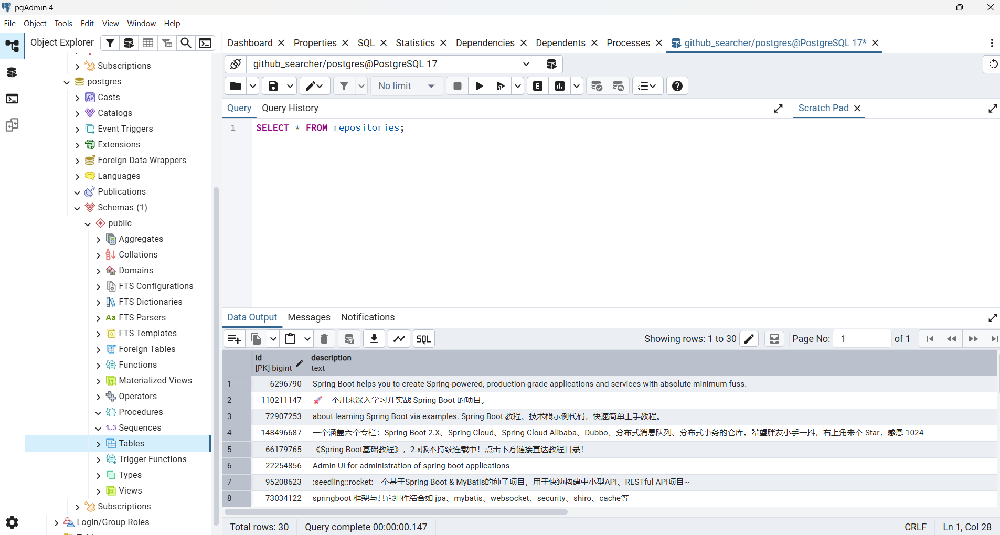
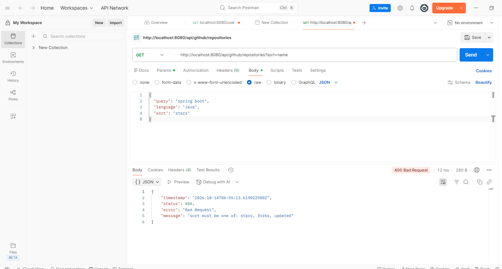
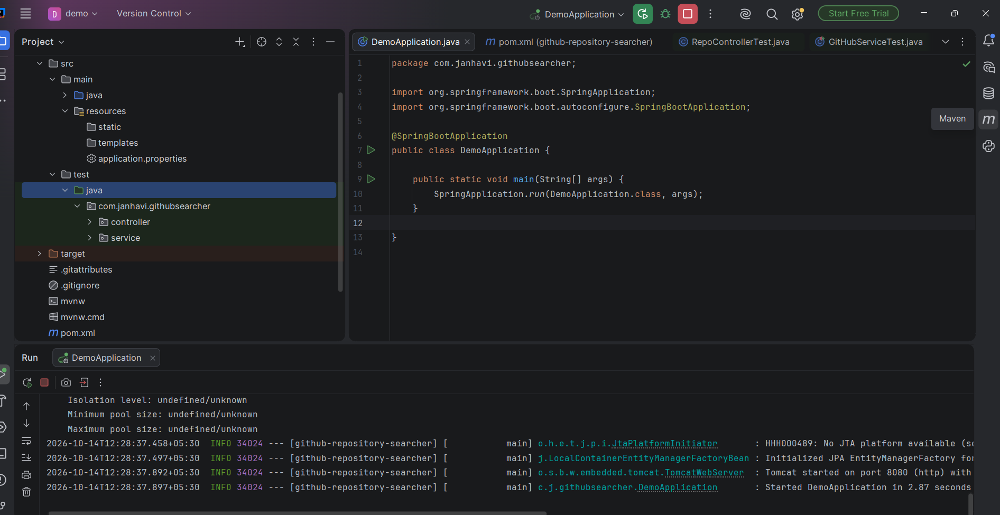

# GitHub Repository Searcher

A Spring Boot REST API that searches GitHub repositories using the GitHub REST API, stores the results in PostgreSQL, and lets you query the stored results with filters.

## Live Demo

- **API base URL:** `https://YOUR-APP.onrender.com`
- **Swagger UI:** `https://YOUR-APP.onrender.com/swagger-ui.html`

> Hosted on Render's free plan. The first request after a period of inactivity can take up to a minute while the server wakes up.

## Features

- Search GitHub repositories by name (partial or full match), programming language, and sort order (stars, forks, or last updated)
- Save the results in PostgreSQL with the repository ID, name, description, owner, language, stars, forks, and last updated date
- No duplicates: if a repository is already saved, its row is updated with the latest details
- Retrieve saved repositories filtered by language and minimum stars, sorted by stars, forks, or last updated date
- Clear error responses for invalid input, GitHub rate limits, GitHub failures, and empty search results
- Interactive API docs with Swagger UI (springdoc-openapi)
- Unit tests for the controller and service layers
- Dockerized and deployed on Render with a hosted PostgreSQL database

## Tech Stack

| Layer | Technology |
|---|---|
| Language | Java 21 |
| Framework | Spring Boot 3.5 (Web, Data JPA, Validation) |
| Database | PostgreSQL |
| External API | GitHub REST API (`/search/repositories`) |
| Testing | JUnit 5, Mockito, MockMvc |
| API docs | Swagger UI (springdoc-openapi) |
| API testing | Postman |
| Deployment | Docker, Render, Neon (PostgreSQL) |

## Project Structure

```
src/main/java/com/janhavi/githubsearcher
├── config/        RestTemplate and OpenAPI beans
├── controller/    REST endpoints and redirect from / to Swagger UI
├── dto/           Request body with validation
├── exception/     Custom exception and global error handler
├── model/         GitHubRepo JPA entity
├── repository/    Spring Data JPA repository
├── service/       GitHub API call, mapping, saving, filtering
└── DemoApplication.java
```

## Getting Started

### Prerequisites

- JDK 21 or newer
- PostgreSQL (with pgAdmin, optional)
- Maven (or use the included `mvnw` wrapper)

### 1. Create the database

```sql
CREATE DATABASE github_searcher;
```

The `repositories` table is created automatically when the app starts.

### 2. Add your database password

Create a file named `local.properties` in the project root (next to `pom.xml`):

```properties
spring.datasource.password=your_postgres_password
```

This file is listed in `.gitignore`, so the password never gets pushed. The app loads it automatically through `spring.config.import` in `application.properties`.

Optional settings you can also put in `local.properties`:

| Property | Default | Description |
|---|---|---|
| `spring.datasource.username` | `postgres` | PostgreSQL username |
| `github.api.token` | empty | GitHub personal access token. Raises the rate limit from 60 to 5000 requests per hour |

### 3. Run the application

```bash
./mvnw spring-boot:run
```

The API starts at `http://localhost:8080` and Swagger UI is at `http://localhost:8080/swagger-ui.html`.

### 4. Run the tests

```bash
./mvnw test
```

## API Endpoints

### 1. Search GitHub repositories

`POST /api/github/search`

**Request body**

```json
{
  "query": "spring boot",
  "language": "Java",
  "sort": "stars"
}
```

| Field | Required | Description |
|---|---|---|
| `query` | Yes | Text to match against repository names |
| `language` | No | Programming language |
| `sort` | No | `stars`, `forks`, or `updated` |

**Response: 200 OK**

```json
{
  "message": "Repositories fetched and saved successfully",
  "repositories": [
    {
      "id": 123456,
      "name": "spring-boot-example",
      "description": "An example repository for Spring Boot",
      "owner": "user123",
      "language": "Java",
      "stars": 450,
      "forks": 120,
      "lastUpdated": "2024-01-01T12:00:00Z"
    }
  ]
}
```

### 2. Retrieve stored repositories

`GET /api/github/repositories?language=Java&minStars=100&sort=stars`

| Parameter | Required | Default | Description |
|---|---|---|---|
| `language` | No | all | Filter by language (case insensitive) |
| `minStars` | No | `0` | Minimum star count |
| `sort` | No | `stars` | `stars`, `forks`, or `updated` (highest or newest first) |

**Response: 200 OK**

```json
{
  "repositories": [
    {
      "id": 123456,
      "name": "spring-boot-example",
      "description": "An example repository for Spring Boot",
      "owner": "user123",
      "language": "Java",
      "stars": 450,
      "forks": 120,
      "lastUpdated": "2024-01-01T12:00:00Z"
    }
  ]
}
```

## Deployment

The app is packaged with the included `Dockerfile` and deployed on Render as a Docker web service. The database is a free PostgreSQL instance on Neon.

Environment variables set on Render:

| Variable | Example |
|---|---|
| `DB_URL` | `jdbc:postgresql://<neon-host>/<db-name>?sslmode=require` |
| `DB_USERNAME` | Neon database user |
| `DB_PASSWORD` | Neon database password |
| `GITHUB_TOKEN` | Optional GitHub token |

## Error Handling

| Scenario | Status |
|---|---|
| Empty `query`, invalid `sort`, malformed JSON, negative or non-numeric `minStars` | 400 Bad Request |
| GitHub rejects the search query | 400 Bad Request |
| GitHub API rate limit exceeded | 429 Too Many Requests |
| GitHub returns an error or an unexpected response | 502 Bad Gateway |
| GitHub API cannot be reached | 503 Service Unavailable |
| Search returns no results | 200 OK with an empty `repositories` list |

**Example error response**

```json
{
  "timestamp": "2026-10-14T06:30:00Z",
  "status": 400,
  "error": "Bad Request",
  "message": "query must not be empty"
}
```

## Screenshots

### Search and save (POST)


### Retrieve with filters (GET)


### Data stored in PostgreSQL


### Validation error


### Tests passing

